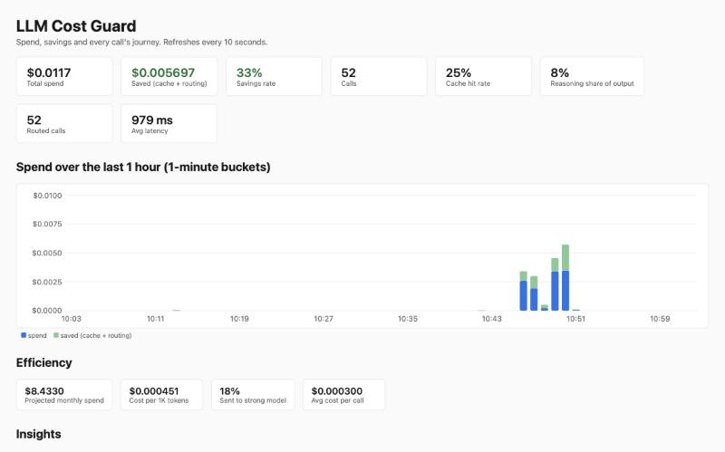

# LLM Cost Guard

[](https://github.com/balakrishnagatla/llm-cost-guard/actions/workflows/ci.yml)
[](https://github.com/balakrishnagatla/llm-cost-guard/actions/workflows/live-smoke.yml)
[](LICENSE)


**A drop-in gateway that shows what every LLM call costs, and cuts that cost automatically.**

Point your app at LLM Cost Guard instead of the AI provider. It measures every call by team, feature and model, and applies four savings levers: **caching**, **model routing**, **reasoning control** and **budgets**, with **failover** to a backup provider when one is rate-limited. Every call is **traced**, and metrics flow to **Prometheus/Grafana** and **OpenTelemetry**.

```
your app ──► LLM Cost Guard ──► Groq / OpenAI / Anthropic / Gemini / Ollama
                 │
                 ├─ measures tokens (incl. reasoning), cost and latency per team & feature
                 ├─ answers repeat questions from cache ($0)
                 ├─ routes simple prompts to a cheap model with low reasoning effort
                 ├─ refuses calls that would push a team over its daily budget
                 ├─ fails over to a backup provider on rate limits and outages
                 └─ traces every call; exports metrics (Prometheus) and spans (OpenTelemetry)
```



📖 **Docs:** [the problem](docs/The-Problem.md) · [how it works](docs/How-It-Works.md) · [results](docs/Results.md) · [observability](docs/Observability.md) · [security](docs/Security.md) · [getting started](docs/Getting-Started.md) · [roadmap](docs/Roadmap.md) · also on the [wiki](https://github.com/balakrishnagatla/llm-cost-guard/wiki)

## Quick start (free, with Groq)

```bash
git clone https://github.com/balakrishnagatla/llm-cost-guard.git
cd llm-cost-guard
cp .env.example .env          # add your free key from console.groq.com/keys as OPENAI_API_KEY
docker compose up -d --build
```

Dashboard: http://localhost:8080. Defaults already target Groq's free `openai/gpt-oss-20b` (cheap) and `openai/gpt-oss-120b` (strong).

```bash
curl -i http://localhost:8080/openai/v1/chat/completions \
  -H "Content-Type: application/json" -H "X-Team: demo" -H "X-Feature: greeting" \
  -d '{"model":"auto","temperature":0,"messages":[{"role":"user","content":"Say hello"}]}'
```

Each response tells you what happened:

```
x-request-id: 4774628f7c7e44c6                # look up its trace at /calls/<id>
x-cost-guard-model: openai/gpt-oss-20b        # chosen by routing
x-cost-guard-route-reason: short, simple prompt
x-cost-guard-cache: miss                      # "hit" on the repeat, at $0
x-cost-guard-upstream: primary                # or the backup provider's name
x-cost-guard-estimate-usd: 0.000307           # pre-call estimate used for budgets
x-cost-guard-cost-usd: 0.000074               # actual cost
```

With the OpenAI SDK, change only the base URL:

```python
from openai import OpenAI
client = OpenAI(base_url="http://localhost:8080/openai/v1",
                default_headers={"X-Team": "search", "X-Feature": "summarize"})
```

## Features

| | |
|---|---|
| **Cost tracking** | Tokens, reasoning tokens, cost and latency per team, feature and model; live dashboard and `/stats` |
| **Cache** | Repeat deterministic calls (`temperature: 0`) answered at $0, isolated per API key |
| **Model routing** | `"model": "auto"` sends simple prompts to the cheap tier, complex ones (tools, long prompts, "analyze", "debug"…) to the strong tier |
| **Reasoning control** | Cheap tier gets `reasoning_effort: low` and an output cap; reasoning tokens are tracked even when the provider doesn't report them |
| **Budgets** | Daily limit per team; each call's cost is estimated first, so a team is stopped *before* it overspends |
| **Failover** | On 429/5xx or outages, retries on backup providers from `routing.json` (e.g. Groq → Gemini) |
| **Streaming** | Pass-through for both APIs, with usage priced from the stream |
| **Tracing & insights** | Step-by-step trace per call, savings rate, top calls, cost per feature, reasoning share, p95 latency |
| **Metrics & traces export** | `/metrics` for Prometheus, ready-made Grafana dashboard, OpenTelemetry spans to Jaeger or any OTLP backend |
| **Security** | Per-team keys, dashboard login, input limits, security headers, hardened non-root container, localhost-only by default |

Why these levers? In a real test, **over 99% of a call's cost was the model's hidden reasoning output** (83 tokens in, 3,072 out). See [Results](docs/Results.md).

## See it with demo data

```bash
pip install -r requirements.txt
python scripts/demo_traffic.py                 # free: simulated provider, opens a demo dashboard on :8090
python scripts/demo_traffic.py --mode real     # real traffic through your gateway and Groq
```

Full observability stack (Grafana on :3000, Prometheus on :9090, Jaeger on :16686):

```bash
OTEL_EXPORTER_OTLP_ENDPOINT=http://jaeger:4318 docker compose --profile observability up -d --build
```

## Configuration

All settings live in `.env` (see [`.env.example`](.env.example)), `routing.json` and `pricing.json`.

| Variable | Default | Meaning |
|---|---|---|
| `OPENAI_BASE_URL` | Groq | Any OpenAI-compatible API |
| `OPENAI_API_KEY` | | Provider key, used when the caller doesn't send one |
| `COST_GUARD_KEYS` | (dev mode) | Per-team gateway keys, `team:key,...` |
| `DASHBOARD_PASSWORD` | (open) | Protects the dashboard and `/stats` |
| `BUDGETS` | | Daily USD limit per team, `team:amount,...` |
| `DEFAULT_OUTPUT_ESTIMATE` | `1024` | Output tokens assumed in estimates when a request sets no limit |
| `GEMINI_API_KEY` etc. | | Keys for backup providers listed under `fallbacks` in `routing.json` |
| `CACHE_MODE` | `deterministic` | `deterministic`, `all` or `off` |
| `MAX_BODY_BYTES` | `1000000` | Largest request accepted |
| `METRICS_TOKEN` | (open) | Bearer token required on `/metrics` |
| `OTEL_EXPORTER_OTLP_ENDPOINT` | (off) | Send OpenTelemetry traces, e.g. `http://jaeger:4318` |

**Failover example** (`routing.json`):

```json
"fallbacks": {
  "openai": [
    { "name": "gemini", "base_url": "https://generativelanguage.googleapis.com/v1beta/openai",
      "api_key_env": "GEMINI_API_KEY", "models": { "*": "gemini-2.5-flash" },
      "drop_params": ["reasoning_effort"] }
  ]
}
```

## Development

```bash
python -m venv .venv && source .venv/bin/activate
pip install -r requirements-dev.txt
ruff check app tests scripts && mypy app && pytest --cov
```

Every pull request runs lint, type checks, 54 tests (85% coverage minimum, currently 96%) with a test report in the job summary, `pip-audit`, `bandit` and a Docker build. A separate [live smoke test](.github/workflows/live-smoke.yml) runs the gateway against the real Groq API on every push to `main` and weekly, using a key stored as a GitHub **environment secret** (never exposed to pull requests). It checks routing, caching, streaming, tracing and that reasoning control keeps simple answers short.

## Security

See [docs/Security.md](docs/Security.md) for the threat model, and [SECURITY.md](SECURITY.md) to report a vulnerability privately.

## License

[MIT](LICENSE)
