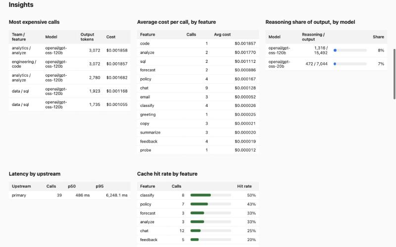

# Results and Findings

## Test setup

- **Provider:** Groq (free tier), OpenAI-compatible API
- **Models:** `openai/gpt-oss-20b` as the cheap tier, `openai/gpt-oss-120b` as the strong tier
- **Prices used:** Groq's published on-demand prices (USD per 1M tokens): 20b at $0.075 in / $0.30 out, 120b at $0.15 in / $0.60 out
- **Calls:** a short greeting (sent twice) and an analysis prompt, all with `"model": "auto"`

## What the dashboard showed

| Metric | Value |
|---|---|
| Calls | 3 |
| Total spend | $0.0019 |
| Cache hit rate | 33% (the repeated greeting) |
| Calls routed automatically | 3 of 3 |
| Average latency | ~2.4 s |

| Feature | Model chosen | Input tokens | Output tokens | Cost |
|---|---|---|---|---|
| greeting (2 calls, 1 cached) | gpt-oss-20b (cheap) | 152 | 454 | $0.0001 |
| analysis | gpt-oss-120b (strong) | 83 | 3,072 | $0.0019 |

Routing behaved as designed: the short greeting went to the small model, and the "analyze … step by step" prompt went to the large one. The repeat greeting came back from cache at $0.

## Key finding: reasoning tokens dominate the bill

The analysis call sent **83 tokens** and got back **3,072**. Most of that output is the model's hidden reasoning, which it produces before answering and which is billed as output. Even "say hello in five words" produced about 227 output tokens per call.

**Over 99% of the analysis call's cost was output tokens.** For reasoning models, the length of the question barely matters; how much the model thinks does.

What this means for cost control:

1. **Measure output, not just input.** Cost dashboards that focus on prompt size miss the real driver.
2. **Control reasoning effort.** Simple tasks should run with low reasoning effort and an output cap. See [Roadmap](Roadmap.md).
3. **Routing pays off twice.** The cheap model is cheaper per token *and* tends to think less on simple prompts.

## Reasoning control: before and after (v0.4)

Same prompt ("Say hello in five words"), same model (`openai/gpt-oss-20b`), real Groq calls:

| | Before (v0.3) | After (v0.4, `reasoning_effort: low`) | Change |
|---|---|---|---|
| Output tokens | 227 | 63 | **72% fewer** |
| Cost per call | $0.000074 | $0.000025 | **66% cheaper** |

The live smoke test in CI now checks that this stays true on every merge.

## Real traffic: 88 calls, 12 teams (v0.5)

Realistic traffic from 12 teams and 13 features (support, search, analytics, engineering, marketing, sales, finance, legal, HR, product, data) through Groq's free tier:

| Metric | Value |
|---|---|
| Calls | 88 (20 answered from cache) |
| Spend | $0.0193 |
| Avoided by cache and routing | $0.0097 (**34% savings rate**) |
| Sent to the strong model | 15% of routed calls |
| Cost per 1,000 tokens | $0.00043 |
| Latency (p50 / p95) | 0.49 s / 6.6 s |

What stood out:

- **A few features drive most of the cost.** An `analyze` call averaged $0.0018 and a `copy` call $0.000016, about **110 times** more. Cost per feature is the number to watch, not cost per team.
- **Strong-model calls are slow as well as expensive.** The p95 latency of 6.6 s comes almost entirely from the strong model producing 1,700 to 3,000 output tokens.
- **Caching pays off on repetitive features.** Support classification and HR policy questions had the highest cache hit rates.

## Security test

The gateway was also run with all protections on and probed like an outsider would:

| Attempt | Result |
|---|---|
| Call without a proxy key / with a wrong key | Refused (401) |
| Open dashboard without password | Refused (401) |
| 2 MB request body | Refused (413) |
| Bill another team by faking `X-Team` | Billed to the key's real team |
| Script tag as a feature name | Stored as `invalid-label`, never rendered |
| Keep calling after the daily budget | Refused (429) |
